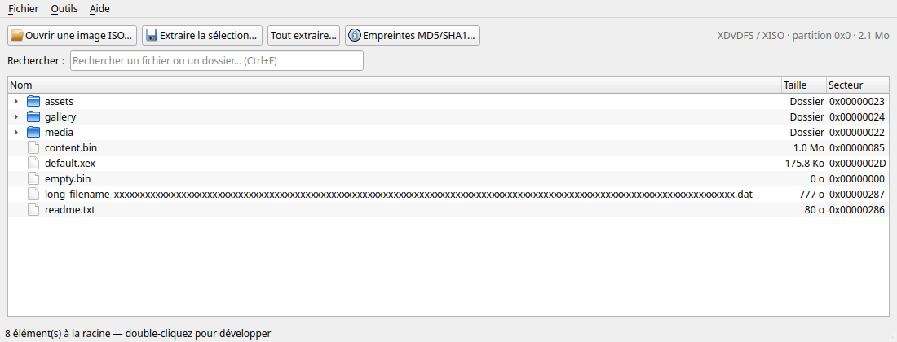
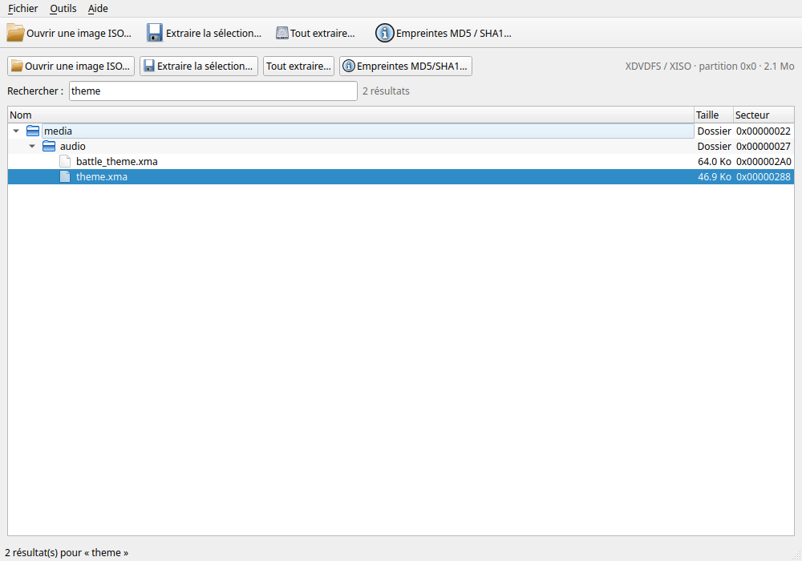
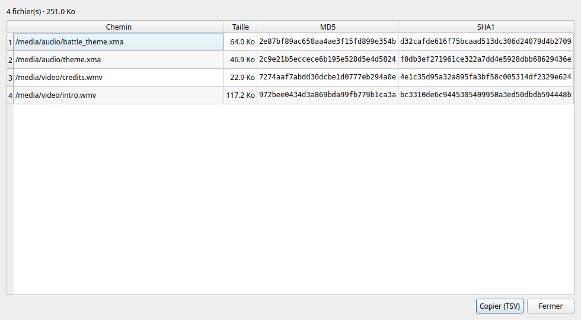

# Xbox Image Browser — XDVDFS (Python / PyQt6)

Explorateur et extracteur d'images disque Xbox / Xbox 360 (`.iso`, `.xiso`) :
lecture du système de fichiers **XDVDFS**, navigation dans l'arborescence et
extraction vers le disque, sans jamais charger l'image complète en mémoire.

## Aperçu



*Image de démonstration ouverte : arborescence chargée à la demande, colonnes
taille et secteur, extraction et empreintes accessibles en un clic.*

## Avertissement

Cet outil est développé à des fins de préservation numérique et
d'interopérabilité. Il ne contient aucun code ni clé propriétaire Microsoft.
L'utilisateur est seul responsable de se conformer aux lois sur le droit
d'auteur applicables dans son pays concernant les fichiers qu'il manipule.

## Fonctionnalités

- Détection automatique du format : XISO / XDVDFS, **XGD2**, **XGD3**.
  Les offsets connus sont testés en priorité, puis l'image est scannée par
  blocs à la recherche de la signature (images non standard).
- Lecture par secteurs de 2048 octets (`seek` + `read`), tables de
  répertoires parcourues via l'arbre binaire gauche/droit.
- Arbre graphique **chargé à la demande** (un dossier n'est lu qu'au moment
  où il est déplié), sélection multiple, glisser-déposer d'une ISO.
- Extraction en **thread séparé** avec barre de progression affichant le
  pourcentage et le compteur de fichiers extraits (`3/8`), bouton Annuler et
  rapport des fichiers ignorés. Copie par blocs de 1 Mio : la mémoire
  reste constante même sur une image de 8 Go. Mesures locales : 300 Mio
  extraits en 0,20 s, MD5 + SHA1 des mêmes 300 Mio en 0,64 s, avec un pic
  RSS d'environ 20 Mio.
- **Recherche instantanée** (`Ctrl+F`) : index complet de l'image construit
  en arrière-plan (5 050 entrées indexées en 36 ms), filtrage de l'arbre avec
  chargement automatique des dossiers parents, plusieurs termes combinés en
  ET, limite de 300 branches affichées pour rester fluide.
- **Empreintes MD5 / SHA1** (`Ctrl+H`) : calcul simultané en un seul passage,
  par blocs, sur les fichiers ou dossiers sélectionnés (récursif), résultats
  copiables au format TSV.
- Noms de fichiers assainis pour l'hôte (caractères interdits, `CON`, `NUL`,
  collisions de casse). `walk()`, `tree_totals()` et l'extraction détectent
  les répertoires cycliques par leurs ancêtres, et `walk()` est plafonné à
  1 000 000 d'entrées pour neutraliser les images piégées.
- Mode ligne de commande pour lister, inspecter et extraire sans GUI.

## Structure

```
.
├── main.py               # point d'entrée : GUI ou CLI
├── gui.py                # interface PyQt6 (arbre, recherche, extraction, empreintes)
├── xdvdfs.py             # parseur / extracteur XDVDFS (aucune dépendance GUI)
├── requirements.txt      # PyQt6
├── build_windows.bat     # build .exe sur Windows (venv, tests, PyInstaller)
├── build_appimage.sh     # build AppImage sur Linux (venv, tests, PyInstaller)
├── XboxImageBrowser.spec # configuration PyInstaller onefile (Windows)
├── packaging/            # version Windows, spec Linux, AppRun et .desktop
├── assets/               # icônes PNG / ICO
├── tools/make_icon.py    # régénération de l'icône (Pillow)
├── LICENSE               # texte GPLv3
├── .github/workflows/    # builds Windows et Linux automatisés (artefacts)
├── demo/demo.iso         # image de démonstration générée localement
└── tests/
    ├── make_test_iso.py  # générateur d'images XDVDFS synthétiques
    ├── test_xdvdfs.py    # parseur, extraction, XGD2/XGD3, scan
    ├── test_cli.py       # mode ligne de commande
    └── test_gui_smoke.py # interface (Qt en mode offscreen)
```

## Installation

```bash
python3 -m venv .venv
source .venv/bin/activate
pip install -r requirements.txt
```

## Utilisation

### Interface graphique

```bash
python main.py                    # fenêtre vide
python main.py demo/demo.iso      # image préchargée
```

1. **Ouvrir une image** — bouton *Ouvrir une image ISO…*, `Ctrl+O`, ou
glisser-déposer un `.iso` / `.xiso` sur la fenêtre. Le format (XISO, XGD2,
XGD3) et la taille sont détectés automatiquement ; l'index de recherche se
construit en arrière-plan.
2. **Naviguer** — double-cliquez sur un dossier pour le déplier (son contenu
n'est lu qu'à ce moment). Les colonnes *Taille* et *Secteur* indiquent la
taille et le secteur de départ ; les dossiers sont regroupés en tête.
3. **Sélectionner** — clic, `Ctrl+clic` ou `Maj+clic` pour plusieurs éléments,
fichiers comme dossiers entiers.
4. **Extraire** — *Extraire la sélection…* (`Ctrl+E`) pour la sélection,
*Tout extraire…* pour l'image entière, ou clic droit → *Extraire*. Choisissez
le dossier de destination : la copie se fait dans un thread séparé, affiche
`pourcentage · 3/8 fichiers extraits` et peut être annulée en cours de route.
Un rapport signale les éléments ignorés (noms invalides, collisions, secteurs
nuls).
5. **Rechercher** — `Ctrl+F`, au moins deux caractères. Le filtre porte sur
les noms et chemins, plusieurs termes se combinent en ET (`media audio`), et
les dossiers parents des résultats sont chargés et dépliés automatiquement,
même s'ils n'avaient jamais été ouverts.
6. **Calculer les empreintes** — sélectionnez des fichiers ou un dossier,
puis *Empreintes MD5/SHA1…* (`Ctrl+H`) ou clic droit → *Empreintes*. MD5 et
SHA1 sont calculés en un seul passage, par blocs, et **Copier (TSV)** exporte
le tableau dans le presse-papiers.

La recherche filtre l'arbre en direct et ouvre les branches nécessaires :



Le tableau des empreintes se copie au format TSV :



### Raccourcis clavier

| Raccourci | Action |
| --- | --- |
| `Ctrl+O` | Ouvrir une image |
| `Ctrl+E` | Extraire la sélection |
| `Ctrl+F` | Rechercher dans l'arbre |
| `Ctrl+H` | Empreintes MD5 / SHA1 |
| `Ctrl+Q` | Quitter |

### Ligne de commande

```bash
python main.py --iso game.iso --info
python main.py --iso game.iso --list
python main.py --iso game.iso --extract media/audio/theme.xma -o sortie
python main.py --iso game.iso --all -o sortie
python main.py --iso game.iso --partition-offset 0xFD90000 --info
```

`--info` affiche le format, la partition et le contenu ; `--list` déroule
l'arborescence ; `-o` choisit le dossier de sortie (dossier courant par
défaut). `--partition-offset` force l'offset de la partition de jeu si la
détection automatique échoue (image retravaillée, offset exotique…).

### Image de démonstration

Aucune ISO commerciale n'est nécessaire pour essayer :

```bash
python tests/make_test_iso.py demo/demo.iso
python main.py demo/demo.iso
```

## Exécutable Windows

PyInstaller ne fait pas de compilation croisée : un `.exe` Windows ne peut pas
être produit depuis Linux. Le projet fournit donc deux chemins pour l'obtenir
sur Windows.

### Option A — sur une machine Windows

1. Installer Python 3.12 depuis [python.org](https://www.python.org/downloads/windows/)
   en cochant **Add python.exe to PATH**.
2. Double-cliquer **`build_windows.bat`**.

Le script crée `.venv-build`, installe PyQt6 + PyInstaller, lance tous les
tests, puis produit :

- `dist\XboxImageBrowser.exe` (onefile, environ 60–90 Mo) ;
- `dist\demo.iso` (image de démonstration à ouvrir directement).

### Option B — GitHub Actions

Pousser le projet sur GitHub, puis **Actions → Build Windows executable →
Run workflow** (ou créer un tag `v1.0.0`). L'artefact
`XboxImageBrowser-windows` contient l'exe et l'ISO de démo. Le workflow
`.github/workflows/build-windows.yml` exécute les tests avant de packager.

### Remarques

- L'exe est **non signé** : SmartScreen peut afficher un avertissement et
  certains antivirus signalent parfois les binaires PyInstaller (faux positif).
- Le mode `onefile` extrait l'application dans `%TEMP%` au lancement : compter
  1 à 3 secondes au premier démarrage.
- L'exe est une application fenêtrée : les options CLI (`--info`, `--list`)
  n'affichent rien dans un terminal. Utiliser `python main.py …` pour le CLI.
- **Licence** : PyQt6 est distribué sous GPLv3. Publier l'exe implique de
  fournir le code source sous GPLv3. Pour une distribution propriétaire,
  utiliser PySide6 (LGPL) ou une licence commerciale Qt.

## AppImage Linux

```bash
./build_appimage.sh
```

Le script crée `.venv-build`, installe PyQt6 + PyInstaller, lance tous les
tests, puis assemble l'AppDir (`packaging/AppRun` et
`packaging/xbox-image-browser.desktop`) et produit :

- `dist/XboxImageBrowser-x86_64.AppImage` (environ 55 Mo) ;
- `dist/demo.iso` (image de démonstration à ouvrir directement).

Prérequis : Python 3 avec le module `venv` et `curl` ; `appimagetool` est
téléchargé dans `.build-tools/` au premier lancement, puis réutilisé.

Le workflow `.github/workflows/build-appimage.yml` construit et publie
l'artefact `XboxImageBrowser-linux` à chaque tag `v*` (ou manuellement).

L'AppImage est autonome (Python, PyQt6 et Qt embarqués) : aucune installation.
Rendre le fichier exécutable si nécessaire (`chmod +x`), puis le lancer ou
double-cliquer dessus.

### Remarques

- FUSE est requis pour exécuter une AppImage. Sur Ubuntu 22.04+ :
  `sudo apt install libfuse2`. Sans FUSE, utiliser
  `--appimage-extract-and-run`.
- Le binaire est lié à la glibc de la machine de build : construire sur la
  distribution la plus ancienne à cibler.
- Application fenêtrée, comme l'exe Windows : pour le CLI, utiliser
  `python main.py …`.

## Détails du format XDVDFS

| Élément | Valeur |
| --- | --- |
| Taille de secteur | 2048 octets |
| Signature | `MICROSOFT*XBOX*MEDIA` (20 octets) |
| Descripteur de volume | secteur 32 de la partition de jeu (`+0x10000`) |
| Racine | secteur `u32` à `+0x14`, taille `u32` à `+0x18` |
| Partition XISO | offset `0x0` |
| Partition XGD2 | offset `0x0FD90000` |
| Partition XGD3 | offset `0x02080000` |

Entrée de répertoire (14 octets + nom, alignée sur 4 octets) :

| Offset | Type | Champ |
| --- | --- | --- |
| `0x00` | `u16` | sous-arbre gauche, en **unités de 4 octets** depuis la table |
| `0x02` | `u16` | sous-arbre droit, idem |
| `0x04` | `u32` | secteur de début (relatif à la partition) |
| `0x08` | `u32` | taille en octets |
| `0x0C` | `u8` | attributs (`0x10` = répertoire) |
| `0x0D` | `u8` | longueur du nom |
| `0x0E` | — | nom ASCII (non terminé par NUL) |

Le parseur suit les liens gauche/droit (avec garde anti-cycle et profondeur
maximale), puis bascule sur une lecture séquentielle si les liens sont
invalides. Les noms sont décodés en latin-1 et les collisions de casse sont
résolues à l'extraction.

## Limites connues

- Extraction en lecture seule : pas de réécriture d'ISO ni de conversion
  GOD / CON.
- Le format XDVDFS stocke les tailles sur 32 bits : aucun fichier de plus de
  4 Gio ne peut exister dans l'image.
- La recherche de secours de la signature est bornée aux 512 premiers Mio
  (les offsets XGD2/XGD3 connus sont testés avant, donc les images standard
  ne dépendent pas de ce scan).
- Les fichiers « vides » avec un secteur 0 sont recréés vides et signalés
  dans le rapport d'extraction.

## Tests

```bash
python -m unittest discover -s tests -v
```

Les 43 tests construisent des images XDVDFS complètes (arbres équilibrés,
répertoires multi-secteurs, préfixes XGD2/XGD3) et vérifient la détection,
la navigation, l'extraction octet par octet, l'annulation, la recherche
instantanée, les empreintes MD5/SHA1, l'interface Qt et la protection contre
les images cycliques ou trop volumineuses.
